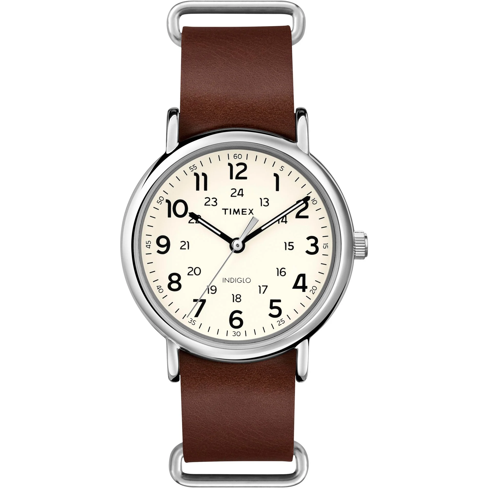
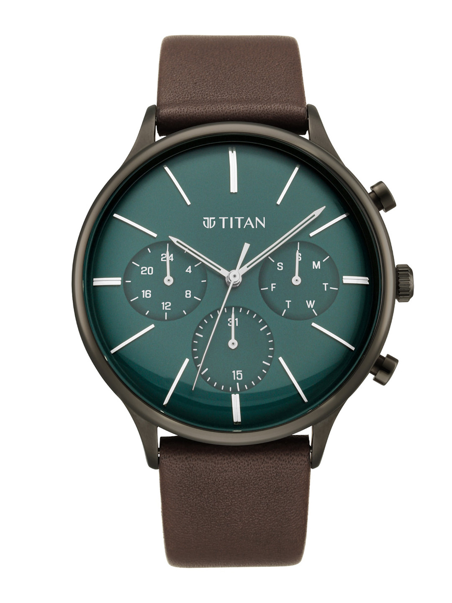
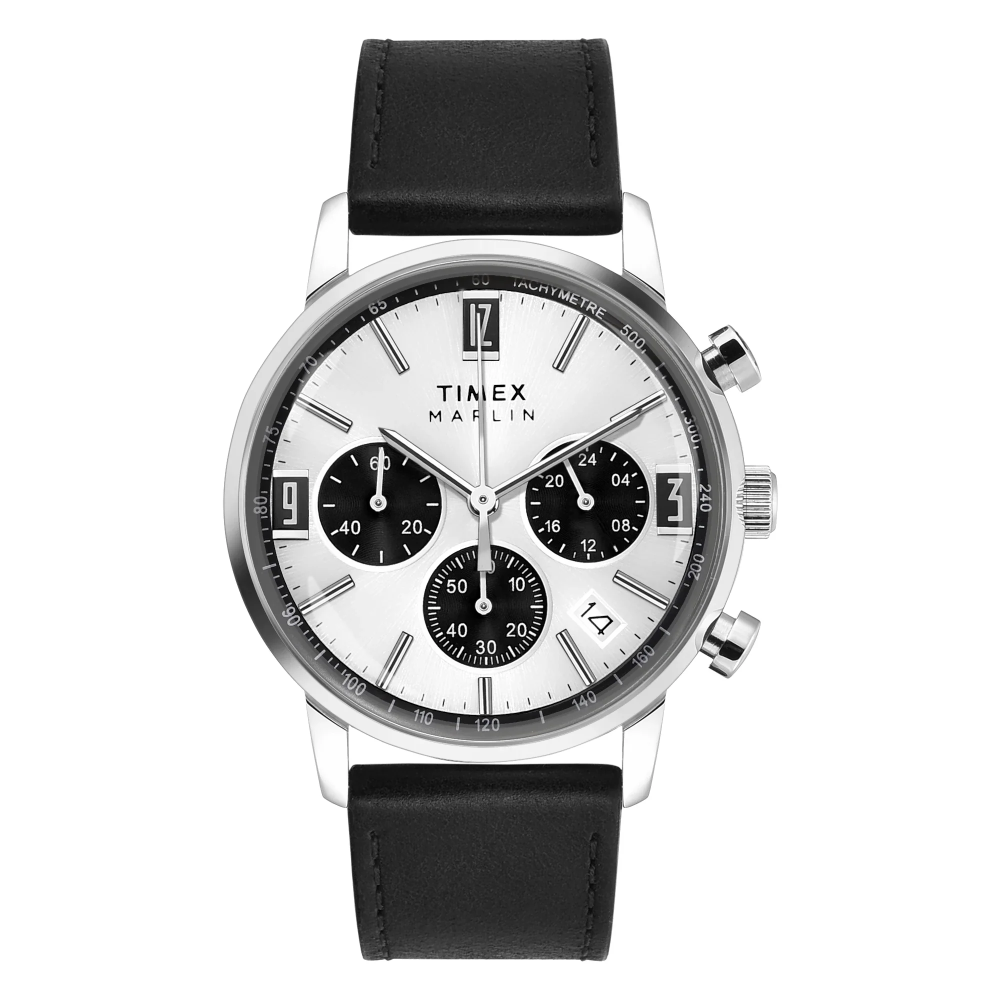
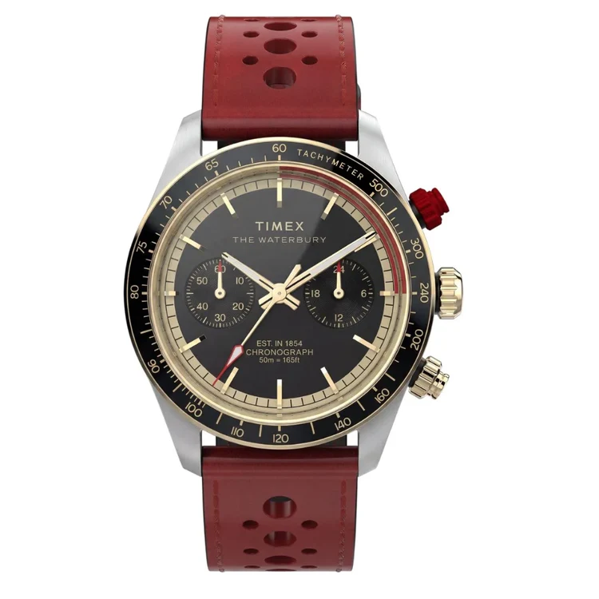
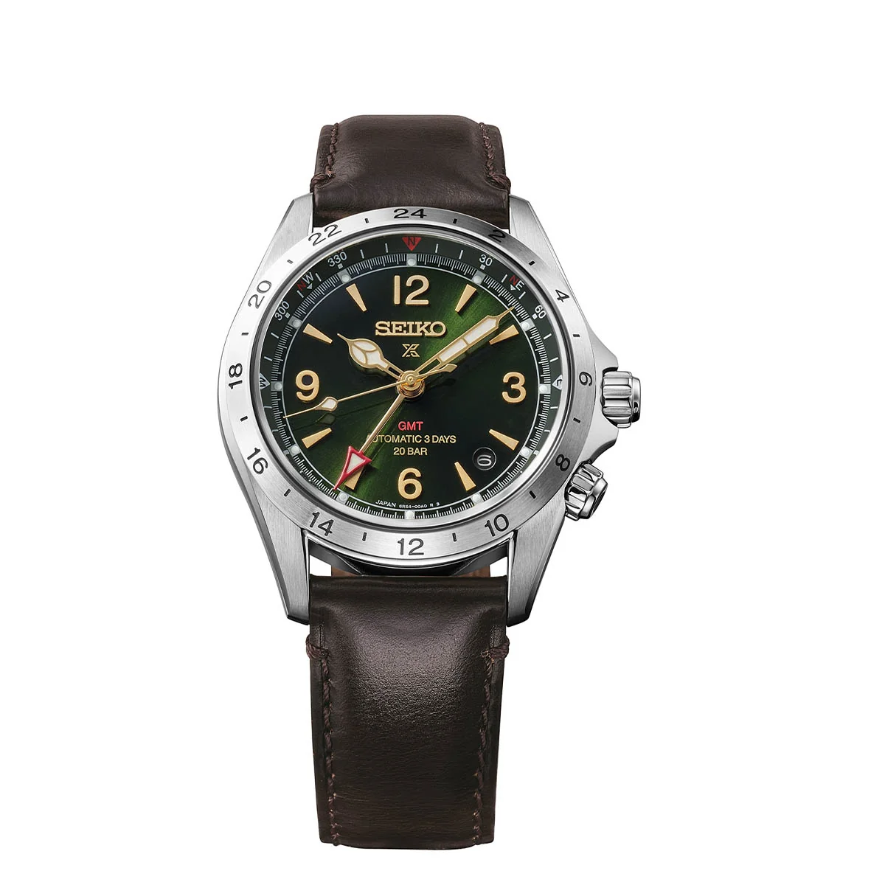
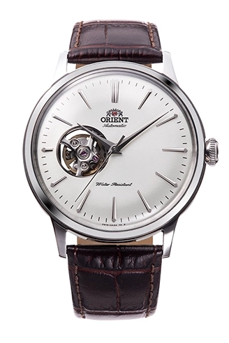
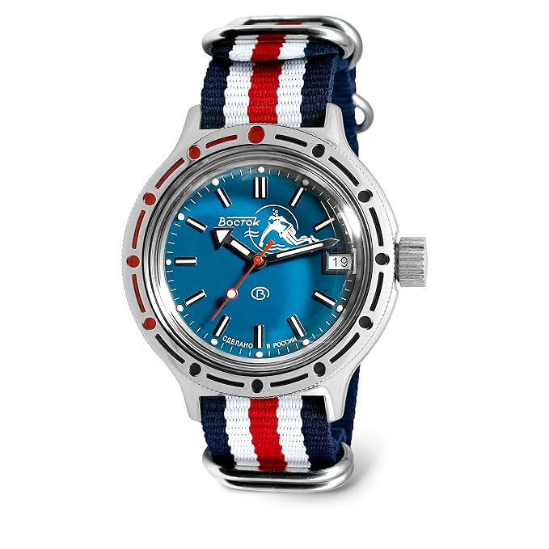
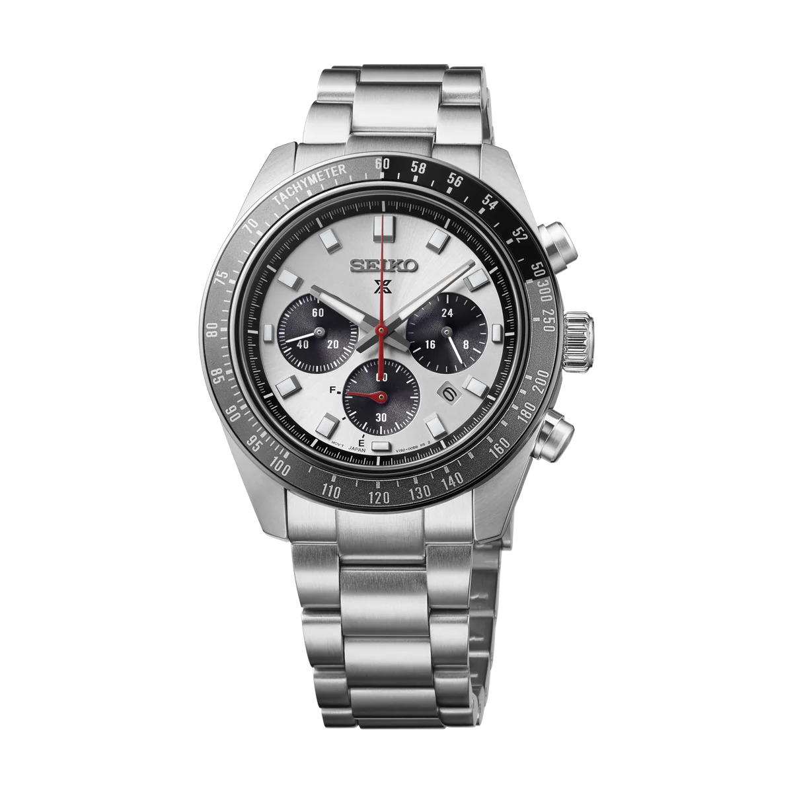

# Watches

Everything on the wrist so far is quartz. Everything next up is mechanical,
starting with the Alpinist GMT.

A watch moves to On the wrist when it arrives, not when it's ordered. Prices
checked September and October 2026. Indian items are MRP or best street price.
Imported items are landed cost, so they already carry the roughly 44 percent
customs hit, converted at about 88 to the dollar.

## On the wrist

- [x] **Casio Vintage** (ref. A158WA-1, D011)

  

  - Case: 36.8mm x 33.2mm x 8.2mm chrome-plated resin, 46g
  - Movement: Quartz digital, 1/100-second stopwatch, daily alarm, hourly
    time signal, auto-calendar, LED light, CR2016 battery, made in China
  - Dial: Digital LCD
  - Crystal: Resin
  - Strap: Stainless steel bracelet, adjustable clasp
  - Water: Splash resistant, no depth rating
  - Cost: 1,695 (Casio India Shop MRP), 1,441 at Opto Watch
  - Where: Casio India Shop, Amazon.in, Opto Watch

- [x] **Timex Weekender 40mm** (ref. T2P495UJ)

  

  - Case: 40mm x 9mm silver-tone brass
  - Movement: Quartz, Indiglo backlight, CR2016 battery, made in the
    Philippines
  - Dial: Cream
  - Crystal: Mineral
  - Strap: Brown leather slip-through, 20mm
  - Water: 30m
  - Cost: 4,197 (Timex India, 40 percent off the 6,995 MRP), 4,195 at Only
    Watches
  - Where: Timex India, Just Watches, Only Watches

- [x] **Casio Edifice Standard Chronograph** (ref. EFV-540DC-1AV, EX414)

  

  - Case: 43.8mm x 12.1mm black ion-plated stainless steel, 48.5mm
    lug-to-lug, screw-lock caseback, 144g
  - Movement: Quartz chronograph with date, subdials for chrono minutes,
    chrono seconds and 24-hour time, SR920SW battery, made in China
  - Dial: Black, black bezel
  - Crystal: Mineral
  - Strap: Black ion-plated stainless steel bracelet, one-push three-fold
    clasp
  - Water: 100m
  - Cost: 10,995 (Casio India MRP), 7,696 at Tata CLiQ Luxury
  - Where: Tata CLiQ Luxury, Citywatches, Swiss Time House

- [x] **Titan Light Leathers Multifunction** (ref. NT90134QL01)

  

  - Case: 42mm x 11mm gunmetal stainless steel
  - Movement: Quartz multifunction, subdials for day, date and 24-hour time,
    made in India
  - Dial: Green
  - Crystal: Mineral
  - Strap: Brown leather, tang buckle
  - Water: 50m
  - Cost: 13,415 (Titan MRP), 10,061 at Lifestyle
  - Where: Titan, Myntra, Lifestyle

- [x] **Timex Marlin Chronograph 42mm** (ref. TWEG26703)

  

  - Case: 42mm x 13mm stainless steel, 55g
  - Movement: VK63 quartz chronograph with date, SR936SW battery
  - Dial: Silver-tone panda with three black subdials and a tachymeter scale
  - Crystal: Acrylic
  - Strap: Black leather, 22mm
  - Water: 50m
  - Cost: 13,495 (Timex India MRP), 11,471 at Watch Brand and Chawla and
    Chhabra
  - Where: Timex India, Just In Time, Swiss Time House, Watch Brand, Chawla
    and Chhabra
  - Note: This is the quartz Marlin, not the hand-wound mechanical one that
    shares the name. Acrylic crystal, so expect to polish out scratches. The
    steel bracelet version is TWEG26704.

- [x] **Timex Waterbury Heritage Chronograph 39mm** (ref. TW2Y93400UJ)

  

  - Case: 39mm x 13.5mm brushed and polished steel, 46mm lug-to-lug, black
    tachymeter bezel, red anodised pusher
  - Movement: Meca-quartz chronograph, SR936SW battery
  - Dial: Black with gold-tone details and black subdials, lumed hands
  - Crystal: Double-domed K1 anti-reflective mineral
  - Strap: Red perforated leather, 20mm, quick-release
  - Water: 50m
  - Cost: 23,995 (Timex India MRP)
  - Where: Timex India, Sai Creations, Ganga Ram's Watch Gallery
  - Note: Meca-quartz, so quartz keeps the time and a mechanical module runs
    the chronograph, which is why the chrono seconds hand sweeps. The red
    motorsport version of TW2Y93300.

## Next up

- [ ] **Seiko Prospex Alpinist Mechanical GMT** (ref. HBC007J1, cal. 6R54)

  

  - Case: 39.5mm x 13.6mm, 46.4mm lug-to-lug, see-through caseback
  - Movement: 6R54 true GMT, 72h reserve
  - Features: Internal rotating compass ring
  - Dial: Green sunray
  - Crystal: Curved sapphire
  - Strap: Cow leather
  - Water: 200m
  - Cost: 1,10,000 available, against the 1,20,000 Seiko India MRP
  - Where: Seiko India, Just In Time, Ethos
  - Note: Comes on leather, not a bracelet. True GMT, so the hour hand jumps
    independently.

- [ ] **Orient Classic & Simple Style Semi Skeleton** (ref. RA-AG0002S)

  

  - Case: 40.5mm x 12mm steel, 46mm lug-to-lug, see-through caseback
  - Movement: In-house F6T22 automatic, hacking and hand-winding, 40h
    reserve, rated -15 to +25 seconds a day, no date
  - Dial: White, open heart at 9 o'clock
  - Crystal: Domed mineral
  - Strap: Brown croc-pattern leather, 21mm
  - Water: 30m
  - Cost: 31,725 (Citywatches India, down from 33,885). Orient India lists it
    at 31,990.
  - Where: Citywatches, in stock, ships from India or Singapore. Orient India
    is sold out, and names only orientwatch.in and Arbana as authorised
    sellers. Indian listings use RA-AG0002S10B.
  - Note: Mineral crystal and only 30m, so it's a desk watch.

- [ ] **Vostok Amphibia Scuba Dude** (ref. 420059)

  

  - Case: 39.6mm x 15mm steel 420 case, 46mm lug-to-lug, screw-down crown,
    bidirectional bezel
  - Movement: Cal. 2416B automatic with date and hand-winding, 31 jewels, 31h
    reserve, rated -20 to +60 seconds a day
  - Dial: Matte blue Scuba Dude, lumed hands and markers
  - Crystal: Domed acrylic
  - Strap: 18mm. Steel bracelet from Meranom; Amazon sellers fit nylon,
    leather or mesh instead.
  - Water: 200m
  - Cost: 16,000 (Amazon.in, October 2026). Has been as low as 15,467 and as
    high as 34,922.
  - Where: Amazon.in, Dropy (22,669 on orange nylon). Meranom direct is 153
    USD, about 19,400 landed before shipping, and takes one to two months by
    Russian post.
  - Note: Listings call it 40mm or 41mm; Meranom measures 39mm across. The
    dial reads blue or teal depending on the production batch.

## Someday

- **Casio AE-1200WHL-5AVDF** (D383)

  

  - Case: 45 x 42.1 x 12.5mm resin, 39g, gold-tone bezel
  - Movement: Digital quartz, ten-year CR2025 battery
  - Features: World time across 31 zones and 48 cities, stopwatch, countdown
    timer, auto-calendar to 2099, LED backlight
  - Crystal: Resin
  - Strap: Burgundy leather
  - Water: 100m
  - Cost: 3,995 (Casio India Shop MRP), 3,795 on Flipkart. Swiss Time House
    and other resellers ask 4,495.
  - Where: Casio India Shop, Flipkart, Swiss Time House, Amazon
  - Note: The AE-1200 everyone calls the Casio Royale, on leather instead of
    the steel bracelet. The glass is resin, not mineral, so it scuffs.

- **Casio Pro Trek PRW-35-7**

  

  - Case: 51.2 x 44.6 x 13mm white bio-based resin, 45g
  - Movement: Tough Solar, Multiband 6 radio sync, about 7 months on a full
    charge, 22 with power saving
  - Features: Triple Sensor (altimeter and barometer, compass, thermometer),
    world time across 31 zones, sunrise and sunset times, LED backlight
  - Dial: Digital LCD
  - Crystal: Mineral
  - Strap: White bio-based resin with slits, buckle
  - Water: 100m
  - Cost: 10,000 available, against the 15,995 India MRP (PRW-35-7DR)
  - Where: Casio India, regularly out of stock. Swiss Time House and
    Citywatches also list it. Japan sells the -7JF at about 24,000 before
    duty.
  - Note: Casio's international site marks it as an old model.

- **Seiko Prospex Speedtimer Solar Chronograph** (ref. HBJ001P1)

  

  - Case: 41.4mm x 13mm
  - Movement: V192 solar quartz chronograph, plus or minus 15 seconds a
    month, roughly 6 months on a full charge
  - Dial: Grey with black subdials
  - Crystal: Curved sapphire
  - Strap: Steel bracelet
  - Water: 100m
  - Cost: 85,000 (Seiko India MRP)
  - Where: Seiko India online store, Seiko Boutique, Ethos
  - Note: Announced September 2026 alongside HBJ002 to HBJ004. Near copies of
    the existing SSC solar Speedtimers, which Seiko India lists at 75,000
    (SSC941P1, SSC943P1, SSC911P1). The difference is the bezel markings.

## Passed on

Keeping these so I stop re-researching them.

| Watch |
| ----- |
| Hamilton Khaki Field Mechanical 38mm (H69439931) |
| Seiko 5 Sports (SRPD53K1) |
| Tissot PRX 40mm (T137.407.11.041.00) |
| Timex Tide, Temp and Compass (TW2Y14400UJ) |
| Sugess Chrono Heritage 1963, 40mm (SU1963SW40/X) |
| CIGA Design Blue Planet, Series U |

## What it all costs

### On the wrist

| Watch | Source | Cost (₹) |
| ----- | ------ | -------: |
| Casio Vintage A158WA-1 | Casio India Shop MRP | 1,695 |
| Timex Weekender T2P495UJ | Timex India | 4,197 |
| Casio Edifice EFV-540DC-1AV | Casio India MRP | 10,995 |
| Titan Light Leathers NT90134QL01 | Titan MRP | 13,415 |
| Timex Marlin Chronograph TWEG26703 | Timex India MRP | 13,495 |
| Timex Waterbury TW2Y93400UJ | Timex India MRP | 23,995 |
| **Total, 6 watches** | | **67,792** |

### Next up

| Watch | Source | Cost (₹) |
| ----- | ------ | -------: |
| Seiko Alpinist GMT HBC007J1 | Street price, MRP 1,20,000 | 1,10,000 |
| Orient Semi Skeleton RA-AG0002S | Citywatches India | 31,725 |
| Vostok Amphibia 420059 | Amazon.in | 16,000 |
| **Total, 3 watches** | | **1,57,725** |

### Someday

| Watch | Source | Cost (₹) |
| ----- | ------ | -------: |
| Casio AE-1200WHL-5AVDF | Casio India Shop MRP | 3,995 |
| Casio Pro Trek PRW-35-7 | Street price, MRP 15,995 | 10,000 |
| Seiko Speedtimer Solar HBJ001P1 | Seiko India MRP | 85,000 |
| **Total, 3 watches** | | **98,995** |

On the wrist and next up together: **₹2,25,517**. With someday: **₹3,24,512**.
